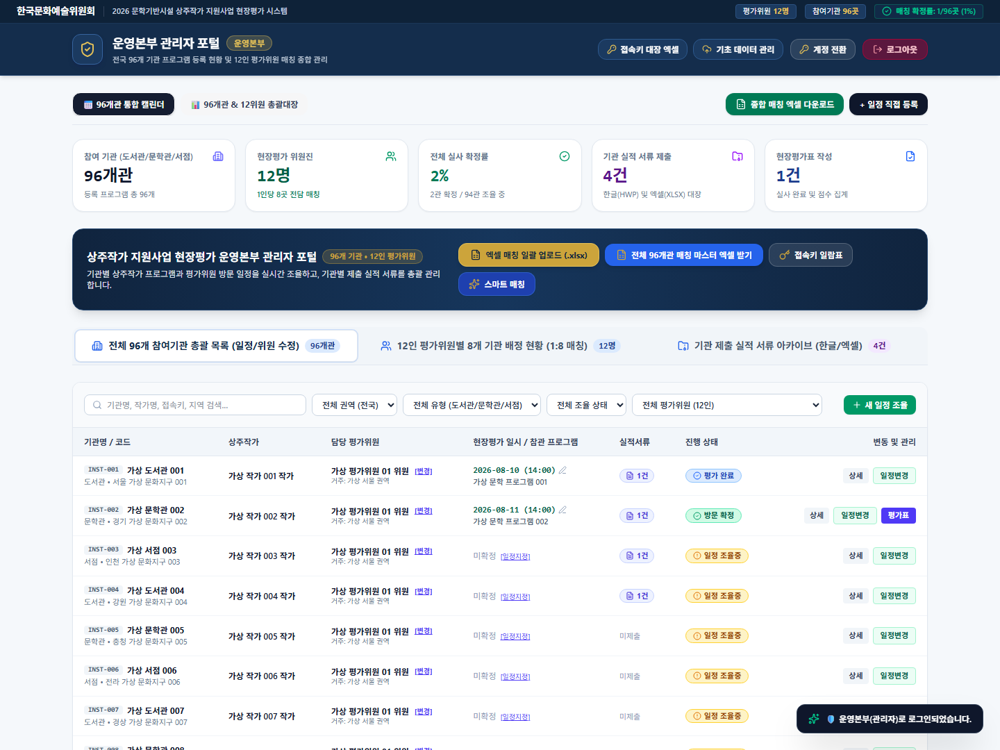
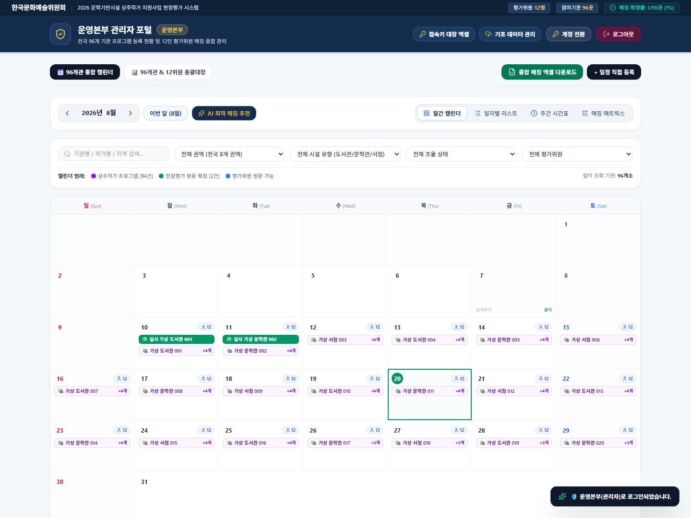
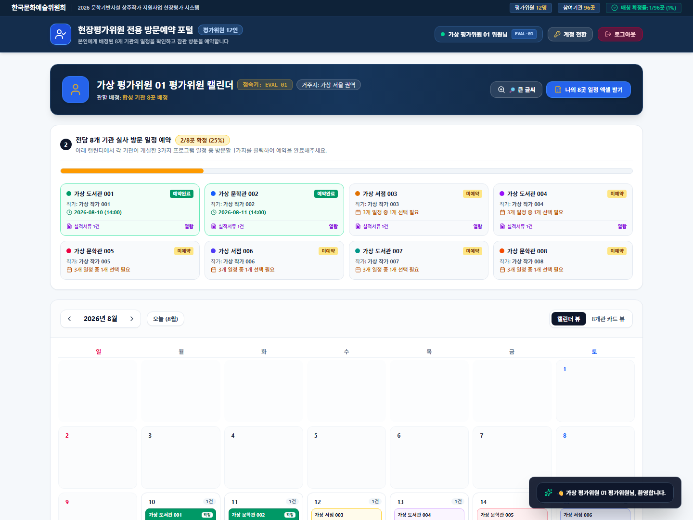
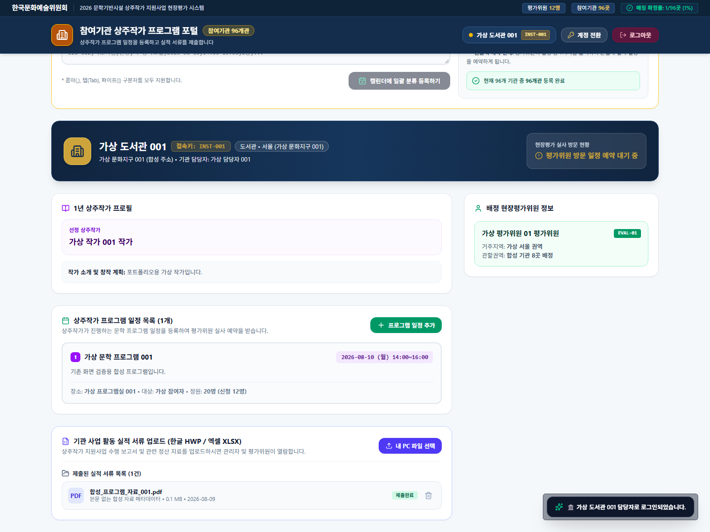
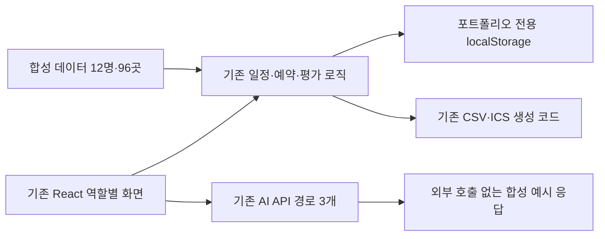

# Arts Scheduling Platform — 현업 요청 기반 일정 조율 웹서비스

**기존 `arco-calendar`의 React UI·업무 기능·구조를 유지하고, 개인정보와 업무 기록을 합성 데이터로 교체한 공개용 포트폴리오 버전입니다.** 새로 디자인한 독립 데모가 아닙니다.

한국문화예술위원회 관련 사업의 현업 담당자로부터 평가위원·참여기관 간 일정 조율과 평가자료 관리를 효율화할 플랫폼 개발을 요청받았습니다. 업무 요구사항을 기능으로 정리하고 Google AI Studio로 웹서비스를 구현했으며, Vercel 배포 후 담당자에게 시연해 긍정적인 피드백을 받았습니다. 이 개발·배포·시연 경험은 작성자의 설명에 근거합니다.

실제 프로젝트 경험을 소개하되 화면의 기관·평가위원·작가·담당자·일정·평가 기록은 모두 합성 데이터로 교체했습니다. **기관의 공식 공개 서비스나 실제 운영 데이터가 아닙니다.**



## 해결하려던 문제

기관의 프로그램 일정, 평가위원의 가능일, 방문 예약, 평가자료와 평가표를 각각 관리해야 하는 업무를 하나의 웹 플랫폼에 연결하려 했습니다. 담당자의 설명을 사용자 역할과 필요한 정보·일정 상태·다음 행동으로 구체화한 경험이 핵심입니다.

## 유지한 기능과 확인 범위

| 사용자 업무 | 기존 구현을 유지한 범위 | 코드 |
|---|---|---|
| 운영 담당자 | 96개 기관·12명 평가위원 총괄대장, 기관 검색·필터, 일정·담당 위원 변경 | [AdminDashboard](src/components/AdminDashboard.tsx) |
| 일정 조회 | 월간·일자별·주간·매칭 매트릭스 캘린더와 필터 | [CalendarHub](src/components/CalendarHub.tsx) |
| 평가위원 | 배정 기관의 프로그램 예약·변경·취소, 개인 CSV | [EvaluatorPortal](src/components/EvaluatorPortal.tsx) |
| 기관 | 프로그램 등록, 자료 메타데이터 추가·삭제, CSV/Excel 입력 | [InstitutionPortal](src/components/InstitutionPortal.tsx) |
| 평가 기록 | 기존 배점·의견 입력·평가서 저장·인쇄 | [EvaluationFormModal](src/components/EvaluationFormModal.tsx) |
| 일정 추천 | 기존 날짜·권역·배정 기준의 규칙 기반 매칭 | [calendarUtils](src/utils/calendarUtils.ts) |
| 생성형 AI 화면 | 기존 Gemini 도우미 컴포넌트·API 3개 계약 유지, 서버 응답만 합성 예시로 대체 | [AIAssistantModal](src/components/AIAssistantModal.tsx), [안전한 응답](portfolio-api.ts) |

자료 선택은 파일명·크기·유형을 브라우저 상태에 추가하는 **메타데이터 관리**입니다. PDF/HWP 본문 업로드·영구 저장·서버 DB·서버 인증·실시간 다중 사용자 동기화를 구현했다고 주장하지 않습니다. 기존 로그인은 클라이언트 화면 전환 방식이며 운영용 인증으로 사용할 수 없습니다.

제안 생성은 기존 조율 화면에서 확인했습니다. 제안 수락·가용일 변경 콜백, Gemini 도우미와 ICS 생성 코드는 보존했지만 일부 UI 진입점은 원본에서 연결되지 않았습니다. 신규 버튼을 붙여 구현된 것처럼 보이게 하지 않았습니다. Gemini 화면과 ICS는 별도 테스트 하네스에서 검증했습니다. [기능별 검증 범위](docs/changes.md)

## 실제 화면

모두 기존 컴포넌트를 **가상 기관·작가·평가위원·일정으로 실행한 실제 캡처**입니다. 96곳·12명은 기존 화면 구조를 유지하기 위한 합성 데이터의 수이며 운영 실적이 아닙니다.

| 통합 캘린더 | 평가위원 방문예약 | 기관 자료 관리 |
|---|---|---|
|  |  |  |

## 기술 스택과 구조

원본의 **React 19·TypeScript·Vite 6·Tailwind CSS 4·Express·Motion·Lucide·XLSX** 구성을 유지합니다. Google AI Studio는 개발 도구, Vercel은 작성자가 설명한 기존 서비스의 배포 환경입니다. 이번 복사본은 배포하지 않았습니다.



원본에는 Gemini SDK 호출 코드와 별도의 규칙 기반 추천 코드가 있습니다. 복사본에서는 실제 인물·기관 정보가 외부에 전달되지 않도록 공급자 호출을 제거하고 기존 응답 형식의 예시만 반환합니다. 키를 설정해도 Gemini를 호출하지 않습니다.

## 본인의 역할과 결과

- 현업 담당자의 요청을 듣고 업무 문제·필요 기능을 정의했습니다.
- Google AI Studio를 활용해 화면과 기능을 구현·수정하고 동작을 확인했습니다.
- Vercel에 배포한 결과를 담당자에게 시연하고 피드백을 확인했습니다.

직접 코딩 비율·팀 관리·사용자 수·업무 절감률 등 확인되지 않은 성과는 주장하지 않습니다. 정식 업무 운영으로 이어지지는 않았으며, 문제 정의→기능 구현→배포→현업 피드백 경험을 중심으로 설명합니다. 이는 일동제약그룹 AI 서비스 개발 직무의 현업 협업·요구사항 분석·업무 웹서비스화와 연결됩니다.

## 로컬 실행

Node.js 22에서 검증했습니다. 실제 개인정보·업무 문서를 입력하지 마세요.

```bash
npm ci --ignore-scripts
npm run dev
# http://127.0.0.1:5190

npm run typecheck
npm test
npm run build
npx playwright install chromium
npm run test:e2e
npm run check:public
```

체험 ID: 관리자 `ADMIN-2026`, 평가위원 `EVAL-01`, 기관 `INST-001`. 비밀번호 `1234`는 기존 UI의 데모 동작용 공통 값이며 실제 인증정보가 아닙니다. 캘린더는 기존 기본값인 2026년 8월입니다.

저장 키는 `arco_portfolio_synthetic_v1_*`로 분리했습니다. 원본 `arko_*` 데이터는 읽거나 지우지 않습니다. 합성 인물·기관 식별자가 아닌 저장값은 초기 합성 데이터로 복구합니다.

## 변경·검증 문서

- [최소 수정 목록·원본 기능의 제한](docs/changes.md)
- [보안·파일 포함/제외·권한 확인 보고서](docs/publication-report.md)
- [원본 파일별 동일/변경 해시](docs/source-manifest.json)
- [스크린샷 조건](screenshots/README.md)

새 테스트와 데이터 안전화는 이번 복사본의 검증 작업이며 원본 서비스의 기존 성과로 소급하지 않습니다. 원본 코드의 공개 권한과 회사의 외부 소개 정책 확인 전 GitHub 업로드·Public 전환을 진행하지 않습니다.
